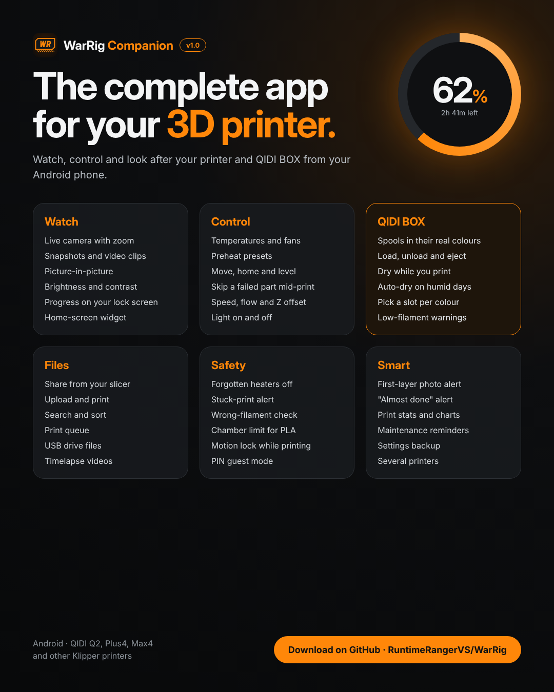
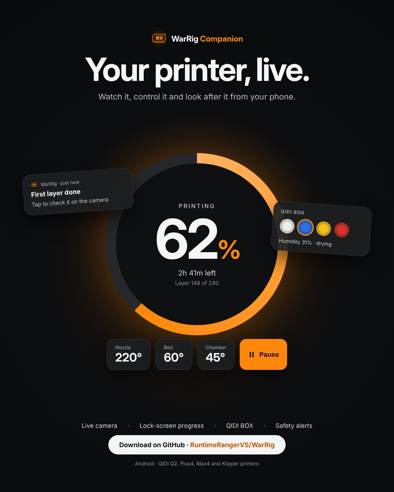
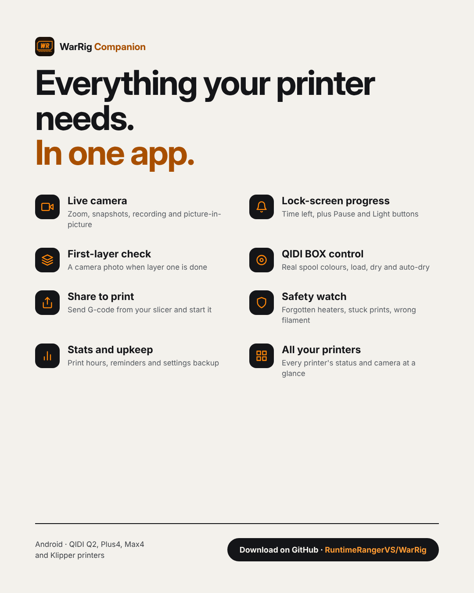
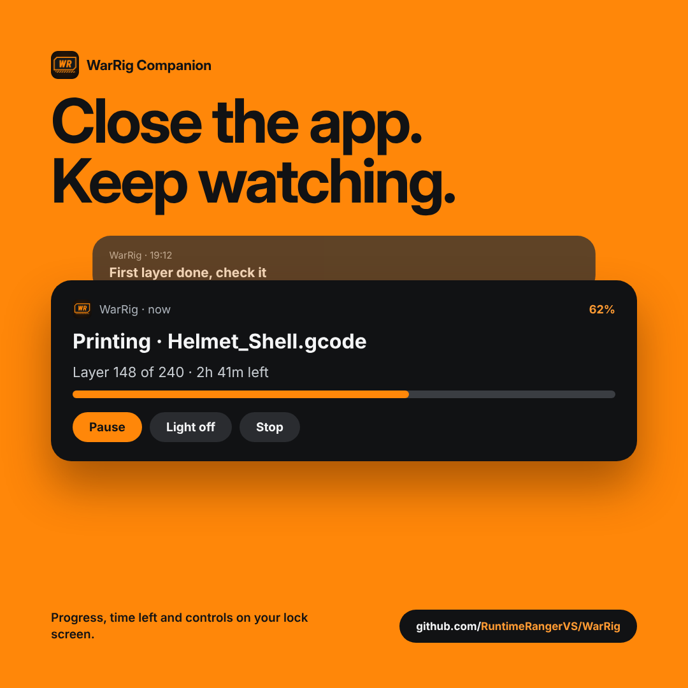
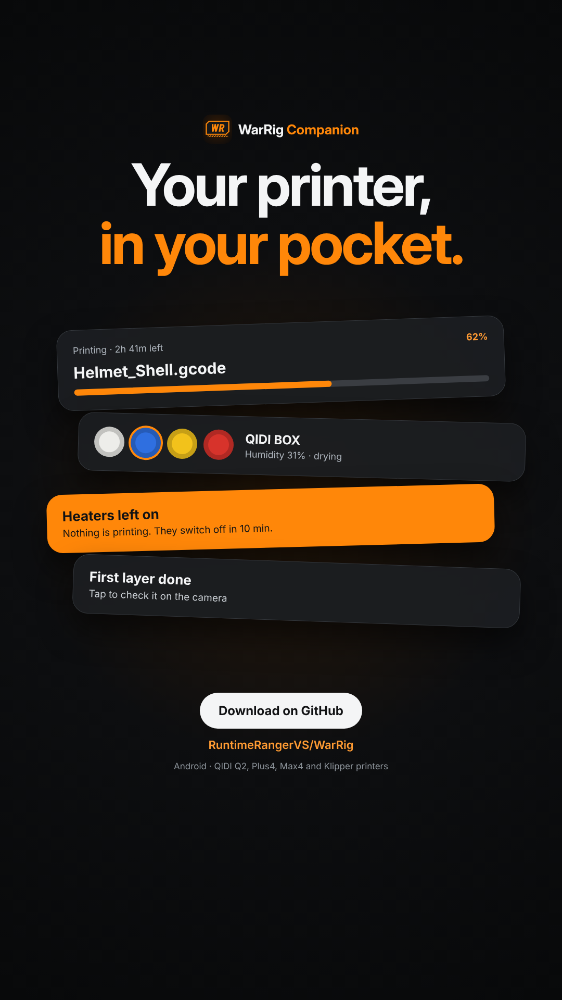

# WarRig Companion

  

  
  
  
  

**The Android app for your QIDI 3D printer.** Watch, control and look after your printer and QIDI BOX from your phone, with safety features that keep watching even when the app is closed.

Works with official QIDI firmware, and with WarRig firmware once it is released.

---

## Contents

- [What's new in 1.2.1](#whats-new-in-121)
- [Supported printers](#supported-printers)
- [Features](#features)
- [Download and install](#download-and-install)
- [First start](#first-start)
- [Settings explained](#settings-explained)
- [Safety](#safety)
- [Privacy and permissions](#privacy-and-permissions)
- [Troubleshooting](#troubleshooting)
- [Roadmap](#roadmap)
- [License](#license)

---

## What's new in 1.2.1

- **WarRig Link:** add a printer by scanning a QR code instead of typing its address. It works with the code on the WarRig printer screen, in WarRig Slicer, or on another phone
- **Open links straight in the app:** scanning a WarRig Link with your normal camera app, or tapping one, opens WarRig Companion and offers to add the printer
- **Share a printer:** show any saved printer as a QR code so another phone can add it in seconds. The API key is only included if you choose
- The app always shows what a code contains and asks before adding or connecting

---

## Supported printers

WarRig Companion talks to **Moonraker**, the service that runs alongside Klipper firmware. When it connects it checks what your printer has and picks the right commands for it. Controls your printer doesn't have stay visible but greyed out, marked **Not on this printer**.

| Printer | Support |
| --- | --- |
| QIDI Q2 / Q2C | Full, including the QIDI BOX (main test printer) |
| QIDI Plus4, Max4 | Full, including the QIDI BOX |
| QIDI Q1 Pro, X-Plus 3, X-Max 3 | Everything except the QIDI BOX |
| Other Klipper + Moonraker printers (Voron, Sovol SV08, Elegoo Neptune 4, rooted Creality K1, Sonic Pad …) | Camera, files, temperatures, motion, alerts, stats, backup and calibration. Case lights (pin or LED strip), quad gantry levelling, standard Klipper Z offset saving, and Happy Hare / AFC filament units are supported. QIDI-only buttons are greyed out |
| Bambu Lab, stock Prusa, stock Creality K1, Marlin-only printers | Not supported (no Moonraker) |

> Only the QIDI Q2 has been tested so far. Reports from other printers are welcome in [Issues](../../issues).

---

## Features

### Watch
- **Live camera:** smooth MJPEG stream with pinch zoom up to 6×, pan, rotate and flip, at home or away (see [Away from home](#away-from-home))
- **Snapshots and video clips** saved to your phone
- **Picture-in-picture:** keep the camera in a small floating window
- **Picture adjustments:** brightness, contrast, saturation and more, where the camera supports them
- **Saver mode:** a still picture every 1.5 s to save battery and Wi-Fi (off by default), and an automatic **data saver** away from home
- **Camera resolution and frame rate** set from the app, with a backup of the old settings
- **Live print notification:** progress bar, layer and time left on your lock screen, with **Pause / Resume** and **Light** buttons
- **First-layer check:** an alert with a camera photo when the first layer is done, with an option to pause after layer 1
- **"Almost done" alert** about 10 minutes before a print finishes
- **Print alerts:** finished, cancelled, paused (with the reason: tangle, run-out, clog …) and errors; only important events notify your phone
- **Home-screen widget** with progress, time left and temperatures
- **Quick Settings tile:** printer state and time left in your phone's pull-down tiles; tap it to open the app
- **Failed print watch:** alerts when the filament sensor stays empty, or the nozzle or bed falls well below its temperature mid-print. Can also pause the print
- **Printer-sent alerts** through the free ntfy app, so they arrive even when your phone can't reach the printer

### Control
- Nozzle, bed and chamber temperatures
- Part, auxiliary and chamber fans
- **Preheat presets** for PLA, PETG, ABS/ASA and more
- Move, home and level, with step sizes and a bed up/down pad
- Speed, flow and live Z offset (babystep)
- Case light on/off, including Klipper pin and LED-strip lights
- **Printer info card** on Home: firmware, Klipper and Moonraker versions, CPU temperature and load, memory and storage at a glance; tap for full details
- **Skip a failed part mid-print** (exclude object) from a plate map
- **Live Tune:** adjust flow, speed, pressure advance and Z offset mid-print and see the effect straight away
- Calibration tools: bed level and mesh, Z offset, input shaper, PID, flow, pressure advance (with tower), extruder, Z tilt or quad gantry, retraction, probe accuracy, bed screws, and a visual bed mesh
- Console for advanced users, behind a beginner warning
- Emergency stop and firmware restart

### QIDI BOX and other filament units
- Every slot shown in its **real spool colour**, with material and brand
- **Load, unload and eject** filament from your phone
- **Dry while you print**, kept at a safe temperature for the loaded filament
- **Spool-turning drying** (QIDI's own program) once all filament is ejected and the ends are secured (NOT TESTED)
- **Auto-dry:** starts the dryer when humidity goes over your limit, for a set time
- Humidity and temperature for each BOX
- Pick which slot each colour of a print uses, matched automatically by colour and material
- Spool notes with grams left, and **low-filament warnings**
- **Spoolman:** if your printer uses Spoolman, see the active spool, choose another and see the weight left on every spool
- Supports up to 4 BOXes (16 slots)
- **Happy Hare** MMUs (ERCF, Tradrack, 3MS …) and **AFC** units (Box Turtle, Night Owl …): load, unload, eject, select, edit filament details and drying where fitted (NOT TESTED)

### Files
- **Share to print:** use "Share" or "Open with" in your slicer, Drive or file manager to send G-code straight to the printer
- Upload, then print with one tap
- **Search and sort** by name, date, size, print time or filament
- Slicer thumbnails, print time and filament use
- **Layer preview:** step through a file layer by layer, seen from above, before you start it
- **Print queue** with an "up next" banner
- Files on a **USB drive** plugged into the printer
- **Timelapse videos:** play, download or delete

### Safety
- **Forgotten heater guard:** if heaters are on and nothing is printing, you get an alert, then they switch off. Calibration and the BOX dryer are never touched
- **Stuck print alert** when progress stops moving
- **Filament checks before printing:** warns if a slot holds the wrong material or doesn't have enough filament left
- **Chamber limit for PLA:** keeps the chamber at 45 °C or less with PLA loaded
- **Motion lock:** blocks homing, jogging and calibration during a print; filament changes still work while paused
- **Control PIN (guest mode):** others can watch, only you can control. Emergency stop always works

### Smart extras
- **Print statistics:** hours, success rate, filament used, a 6-month chart, hours per week and filament by material
- **Print cost:** filament and electricity cost per print and for the last 6 months, using your own prices and currency
- **Maintenance reminders** based on print hours, for example plate, rods, nozzle and belts, with your own intervals
- **Settings backup:** copies the printer's config files to `Downloads/WarRig` on your phone. Read-only on the printer
- **Weekly backup** and **automatic timelapse download** (optional)
- **Several printers:** save, rename and switch between them, see all of them at a glance, and **find printers on your Wi-Fi** automatically
- **WarRig Link:** add a printer by scanning its QR code, and share a saved printer as a QR code
- **App icon shortcuts:** long-press the icon for Camera, QIDI BOX, Files or All printers
- **Languages:** English, German, French, Spanish and Italian
- **Tablet and landscape layout** with side tabs and two pages side by side
- **Automatic update check** when the app opens

### Not tested yet

These are in the app and marked **NOT TESTED** until they have been tried on a real printer:

- Smart plug control (Shelly, Shelly Plus / Gen 2+, Tasmota, or a Moonraker power device): power off after a print and power cut on a heater error
- Air filter run after ABS / ASA / PC / PA prints
- Away-from-home access and printer-sent alerts
- Failed print watch and pausing a failed print
- Spoolman and layer preview
- Spool-turning drying, Happy Hare and AFC units
- WarRig Link QR scanning and sharing

---

## Download and install

1. Open the [latest release](https://github.com/RuntimeRangerVS/WarRigCompanionApp/releases/latest) and download the `.apk` file to your phone.
2. Open it. If Android asks, allow installing apps from your browser or file manager.
3. Open **WarRig Companion**.

The app checks for new versions each time it opens. Required updates must be installed before you carry on; you can also check by hand in **Settings → Updates**.

**Requirements:** Android 8.0 or newer, with the phone on the same network as the printer.

---

## First start

1. When the app opens, tap **Add a printer**, **Scan WarRig Link QR code** to scan the code on the printer screen, or **Find printers on this Wi-Fi** to search automatically.
2. Enter a name and the printer's IP address, for example `192.168.0.66`. You'll find it on the printer screen under network / Wi-Fi settings. Port `7125` is added automatically.
3. Tap the printer to connect. To skip this screen next time, tick **Connect to the last printer automatically**.
4. Optional: in **Settings → Notifications** turn on **Print alerts**, and allow notifications when Android asks.
5. Optional: pick a language in **Settings → Language**. By default the app follows your phone.

If your Moonraker needs an API key, add it in **Settings → Connection**. The key is kept in memory only and never saved on the phone.

### WarRig Link

A WarRig Link holds a printer's name, home address and, if set, its away-from-home address, so you never have to type an IP address.

- **Add:** tap **Scan WarRig Link QR code** in the printer list, or point your phone's camera app at the code. Check the details, rename the printer if you like, then tap **Add and connect**. A printer you already have is updated instead of added twice.
- **Share:** tap the QR button next to a printer to show its code. Tick **Include the API key** only if the other person needs it. Anyone who scans the code can watch and control the printer.
- Codes pointing outside your home network are refused, and away-from-home addresses must be Tailscale or https.

Scanning uses the QR scanner built into Google Play services, so the app doesn't need camera permission.

### Away from home

1. Install [Tailscale](https://tailscale.com) on the printer and on your phone, or put the printer behind your own https address.
2. In the printer list, edit the printer and fill in **Away from home**, for example `100.101.102.103` or `https://printer.example.com`.
3. The app uses the home address on your Wi-Fi and switches to the away address when it can't reach it. A **REMOTE** badge shows when you're connected from outside.

Only Tailscale addresses and https addresses are accepted, so your printer is never exposed to the open internet.

---

## Settings explained

Settings is a short menu. Tap a row to open its page.

| Page | What's there |
| --- | --- |
| Printers (top card) | Switch, add, rename, edit and share printers (WarRig Link QR codes), including the away-from-home address |
| Connection | API key and the features found on your printer |
| Firmware restart | Restart Klipper after an emergency stop or error |
| Notifications | Print alerts, keep watching in the background, printer-sent alerts (ntfy) |
| During a print | Live notification, first-layer check, pause after first layer, almost done, after-print actions (light off, chamber heater off, BOX dryer off) |
| Safety | Heater guard, stuck print alert, failed print watch, PLA chamber limit, motion lock, heater-error power cut, control PIN |
| Automatic | Auto-dry, air filter, power off after print, clear-the-plate alert, light with camera, weekly backup, save timelapses, smart plug |
| Upkeep reminders / Statistics | Maintenance reminders, print statistics and print cost prices |
| Backups | Copy the printer's settings to your phone |
| Language | Phone language, English, German, French, Spanish or Italian |
| Updates | Check for a new version |

---

## Safety

- The app asks you to confirm every action that moves the printer, heats it or starts a print.
- Every start goes through a **"the build plate is clear"** check.
- The console sends G-code with **no safety checks**. Only use it if you know G-code.
- Automatic actions (heater guard, auto-dry, after-print actions, smart plug) are sent like any other command and logged under **Notifications**.
- Klipper's own thermal protection always stays in charge. The app adds to it and never replaces it.

---

## Privacy and permissions

WarRig Companion talks **only to your printer** (and smart plug, if you set one up), plus GitHub for the update check. Away from home it uses the Tailscale or https address you gave it. If you turn on printer-sent alerts, the printer sends short alert messages through ntfy to a random topic only you know. The app has no accounts, no cloud and no tracking.

| Permission | Why |
| --- | --- |
| Internet / network state | Connect to the printer on your network |
| Notifications | Print alerts and the live progress notification |
| Foreground service | Keep watching while the app is closed (it shows its own notification and can be stopped any time) |
| Run at startup | Re-schedule local print-plan reminders only. No printer connection starts at boot |

Snapshots, clips, backups and timelapses are saved to your phone's **Pictures, Movies and Downloads** folders under `WarRig`.

---

## Troubleshooting

**Can't connect**
- Check that the phone is on the same Wi-Fi as the printer, not mobile data or a guest network.
- Check the IP address on the printer screen. Try opening `http://<printer-ip>:7125/server/info` in the phone's browser.
- If Moonraker requires an API key, enter it under **Settings → Connection**.
- Away from home, check that Tailscale is running on both the phone and the printer.

**No camera picture**
- Away from home, the camera needs the away-from-home address set (see [Away from home](#away-from-home)). Data saver may show still pictures instead of video.
- Make sure the printer's webcam is enabled. The app tries the common stream addresses automatically.

**No alerts while the app is closed**
- Turn on **Print alerts**, and either **Keep watching in background** or **Live print notification**.
- For alerts that don't depend on the phone at all, set up **printer-sent alerts** in **Settings → Notifications**.
- Some phones stop background apps. Set WarRig Companion's battery use to **Unrestricted** in Android settings.

**QR scan doesn't start**
- The scanner comes from Google Play services. Update Google Play services, or add the printer by its address instead.

**BOX slot shows the wrong colour**
- The colour comes from the BOX (RFID or saved setting). Tap the refresh button on the BOX page, or set the spool on the printer.

---

## Roadmap

- Tested smart plug, air filter, Spoolman and failed print watch support
- More languages
- More printer models confirmed
- WarRig firmware integration once released

Ideas and bug reports are welcome in [Issues](../../issues).

---

## License

**Copyright © 2026 RuntimeRangerVS. All rights reserved.**

WarRig Companion is closed source. You're welcome to download the official app builds from [Releases](https://github.com/RuntimeRangerVS/WarRigCompanionApp/releases) and use them on your own devices. Copying, modifying or redistributing the app, its code or its graphics isn't allowed without permission. See [LICENSE](LICENSE) for the full terms.

WarRig Companion is an independent project. It is not made, endorsed or supported by QIDI Technology. QIDI, Klipper and Moonraker names are used only to describe compatibility.
